# Footprint Sim

**日本語** | [English](README.en.md)

**足取りが途切れたとき、残された証拠から「どこを探すべきか」を、どこまで安全に絞れるだろうか。**

Footprint Sim は、この問いを**数理・シミュレーション・実データの検証**から調べる研究用シミュレーターです。災害時の行方不明者探索を題材に、本人の記録が途切れていても、他者との遭遇、端末の観測、環境の変化などの情報を組み合わせて候補を絞れる条件と、その限界を調べています。

これは実際の救助に使うシステムではありません。**合成データに基づく研究基盤**であり、現実の所在、危険度、生存可能性、救助成功率を予測・保証しません。実端末を扱う姉妹プロジェクト `footprint` の代替でもありません。



*模式図：証拠が届くたびに探索候補のエリアが絞られていく様子。紫の点線は実際の足取り（推論には渡されず、事後評価にのみ使う）。候補が絞られても、実際の足取りが候補から外れることがない設計が v1 の中核の約束である。*


## 何を解こうとしているのか

例えば、ある人の最後の確認位置が分かっていても、その後の記録がなければ、現在地を一つに特定できません。携帯端末が見つかっても、途中で本人と端末が離れていれば、端末の位置を本人の位置とみなすことはできません。

一方、別の人との遭遇記録や、後から届いた観測が、途切れた移動履歴を制約することがあります。Footprint では本人の移動履歴を**経糸**、他者・端末・環境との関係から得られる証拠を**横糸**に見立てています。

研究の焦点は、単に「候補が減った」ことではなく、次の区別にあります。

- **何を使えたか**：その時点までに受領した証拠だけを推論に使う。未来の情報やシミュレーターだけが知る真値は使わない。
- **何を区別できるか**：同じ情報と公開モデルで説明できる複数の履歴が残るなら、根拠なく一つに決めない。
- **どこまで絞ってよいか**：優先して確認する候補と、安全側に残す候補を分け、未解決・矛盾・不明を「候補なし」と扱わない。
- **本当に役立つ差か**：同じ入力を複数の方法へ渡し、真値の誤除外、候補削減、情報の遅延、計算量などを別々に比較する。

```text
合成世界（真の移動・出来事）
    │
    ├─ 観測・受領済み情報 ──> 公開モデルと制約 ──> 推論手法 ──> 探索候補
    │                                                      │
    └─ 真値（推論には渡さない） ──────────────────────> 事後評価
```

## 研究で分かっていること・まだ分からないこと

| テーマ | 現在の到達点 | 解釈の限界 |
| --- | --- | --- |
| **観測と移動の合成実験** | 徒歩、災害輸送、人物と端末の分離、遭遇、受領遅延などを再現可能なシナリオで扱う | 合成世界の条件は現実の災害を再現・校正したものではない |
| **横糸を用いた過去候補の検討** | 受領済み制約の履歴への適用、公開関係の追跡、過去候補の生成と出所を分けた検証などを実装・比較 | 完全な未知関係発見や因果網の網羅を実現したものではない |
| **公開情報から確認場所への対応** | 地域・候補・確認単位の対応を明示し、未対応や不確かさを区別する限定的な仕組みを検討 | 現場で実際にかかる捜索時間・費用に換算できるわけではない |
| **有限モデル内の到達範囲** | F21で、宣言済みの小さな閉モデルについて1,944通りの照会を独立した参照計算と照合 | 現実の移動経路を網羅するという証明ではない |
| **数理的な情報価値** | 同じ公開情報では区別できない世界、条件付きの安全な縮約、複数証拠の相補性を整理 | 数理ノートは条件付きの論証であり、現行推論方式の優位性や実地有効性を証明していない |
| **実際の徒歩記録との照合** | 限定的な研究と前提条件の確認を進めている | 実災害における安全性、探索効率、救命効果は未検証 |

**複数の証拠は、組み合わせて初めて役立つことがあります。** 数理ノートでは、4つの可能な履歴が2つの確認単位 `{U1, U2}` に対応する例を扱います。証拠 `e1` だけでも `e2` だけでも候補は変わりませんが、両方を同時に満たす正当な制約として採用できると `{U1}` に絞れます。これは**手計算可能な理論例**であり、現在の実装や現場で同じ効果が確認されたという意味ではありません。

根拠と残件は [数理ノート](docs/weft-mathematical-foundations.md)、[F21の有限検証](docs/m1f21-public-transition-coverage-results.md)、[徒歩記録の研究Issue #65](https://github.com/uobnnisiuk/footprint-sim/issues/65) を参照してください。各課題の最新状況はIssue・PRに記録しています。

## 試してみる

### 必要環境

- .NET **8 SDK**（Windows / Linux / macOS。Runtimeだけではビルドできません）
- リポジトリの `global.json` に適合する SDK

```bash
./scripts/check-environment.sh
```

Linux/macOSでSDKが未導入なら、公式の導入スクリプトを使う補助スクリプトがあります。

```bash
source scripts/setup-dotnet.sh
./scripts/check-environment.sh
```

WindowsではMicrosoft公式の.NET 8 SDKインストーラーまたは `dotnet-install.ps1` を利用してください。

### ビルドとテスト

```bash
dotnet restore FootprintSim.sln
dotnet build FootprintSim.sln --no-restore
dotnet test FootprintSim.sln --no-build
```

### 1つのシナリオを実行

次は、災害輸送と**人物・端末の分離**を含む合成シナリオ `S1` の例です。

```bash
dotnet run --project src/FootprintSim.Cli -- \
  --scenario scenarios/s1_debris_transport/scenario.json \
  --seed 42 \
  --output results/s1
```

主な出力は次の4つです。

| ファイル | 内容 |
| --- | --- |
| `ground-truth.events.json` | シミュレーターが知る真値。**推論入力には使わない** |
| `observations.json` | 救助側に渡せる観測記録 |
| `search-zone.summary.json` | 観測と公開モデルに基づく候補領域の要約 |
| `run.metadata.json` | シナリオ、seed、入力ハッシュなどの再現情報 |

同じシナリオファイルとseedでの決定的な再実行を前提としています。出力先の `results/` はGit管理の対象外です。

### 複数の推論方法を比較

例えば `S3` は、本人自身の証拠だけを扱う方法と、受領済みの他者との関係（横糸）を使う方法を、**同じ合成世界・同じseed**で比較するためのシナリオです。

```bash
dotnet run --project src/FootprintSim.Cli -- evaluate \
  --scenario scenarios/s3_cross_thread_encounter/scenario.json \
  --seeds 0..19 \
  --strategies all \
  --output results/s3-comparison
```

集計には `runs.csv`、`aggregate.csv`、`conditions.csv`、`paired.csv`、`manifest.json` などを用います。観測と推論の過程を追いたいときは `--telemetry` を付けられます。**候補が小さいことだけを成功とせず、真値の誤除外や未確定の扱いも確認してください。**

## シナリオと主要な研究テーマ

| シナリオ | 調べること |
| --- | --- |
| **S0** | 徒歩移動と最後の観測（基準ケース） |
| **S1** | 災害による移動、端末との分離、欠落・衝突する観測 |
| **S2** | 確率分岐、堆積・拘束、二次輸送 |
| **S3** | 他者との遭遇情報による履歴制約と手法の比較 |
| **S4** | 複数の横糸による公開関係の因果追跡 |
| **S5** | 分散した証拠からの過去状態候補の再構成 |

S5を基礎とするM1-F系列では、証拠の種類、位置・時刻の精度、関係する人物の曖昧さ、制約の組合せ、候補表現などを条件を固定して比較しています。個別の実験コマンド・前提・結果は各研究文書に記録しています。

### 詳細資料

- [全体構成と真値の隔離](docs/architecture.md) / [シナリオ・移動モデル](docs/model.md)
- [横糸の履歴制約](docs/m1c2-cross-thread-constraints.md) / [複数横糸の追跡](docs/m1d-causal-tracing.md)
- [過去候補の再構成](docs/m1e-past-state-reconstruction.md) / [観測情報を減らす比較](docs/m1f-observation-ablation.md)
- [証拠の出所と論理的な組合せ](docs/m1f14-constraint-composition-contract.md)
- [候補・地域・確認単位の対応](docs/m1f20-public-search-mapping.md) / [有限到達範囲の検証](docs/m1f21-public-transition-coverage-results.md)
- [横糸の情報価値に関する数理ノート](docs/weft-mathematical-foundations.md)
- [開発・検証時のルール](AGENTS.md)

## 設計上の約束と研究の限界

- **真値と観測を混ぜない**：真の移動経路、実際に選ばれた災害分岐、乱数の結果などは推論手法へ渡しません。真値は結果を出した後の採点にのみ用います。
- **人物と端末を混同しない**：両者が分離した場合、それぞれ別の位置履歴を持ちます。
- **不明を勝手に否定に変えない**：未受領の証拠、未公開の経路、未対応の地域、矛盾は別々に扱います。情報不足のときに「捜索対象は存在しない」と結論しません。
- **比較条件を揃える**：方式間で使える公開情報を揃え、出力はscenario・seedで再現できる形にします。合成データでの比較値を現実の性能に読み替えません。
- **実際の探索への転用を前提にしない**：災害の物理シミュレーション、観測装置の精度校正、リアルタイムの現場運用、24縁全体の実装、救助判断の最適化などは未完成・未評価です。

**Footprint Sim の目的は、分からないことを隠さずに、残された情報から言えることを一つずつ増やすことです。**